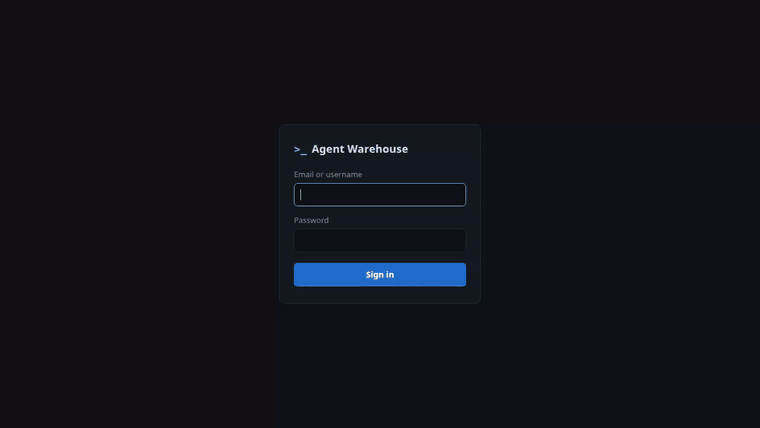
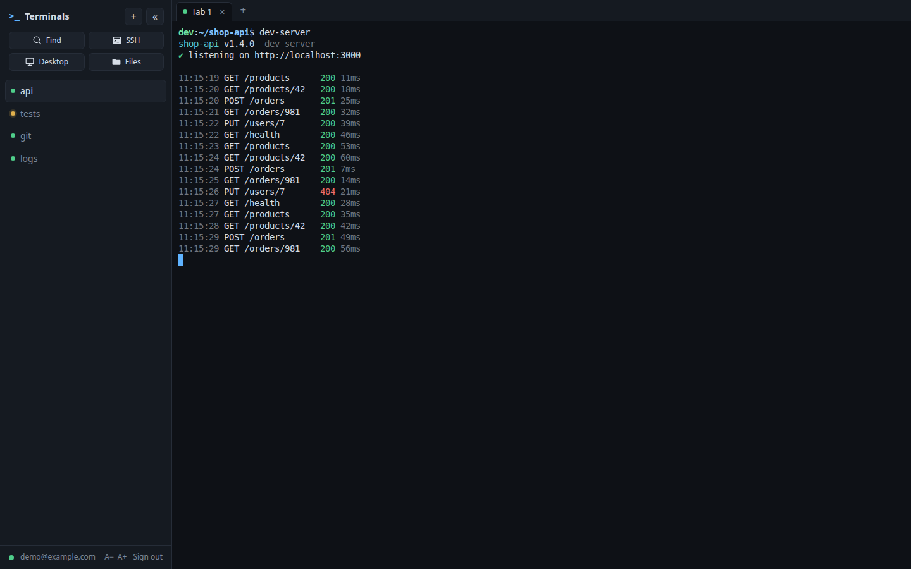
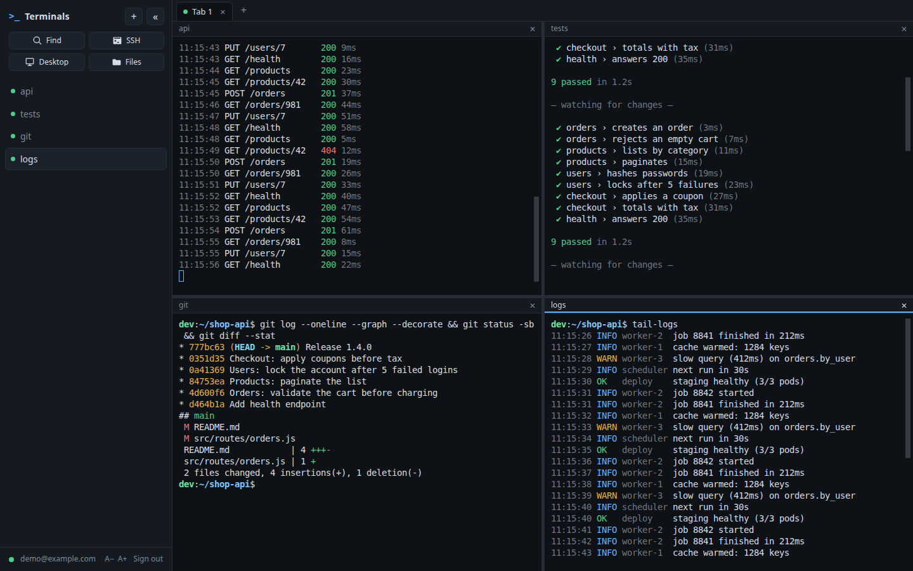
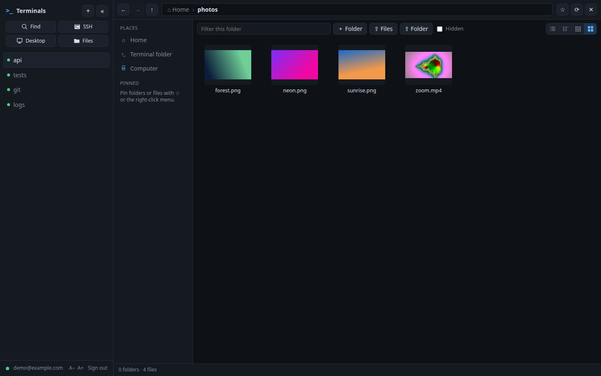
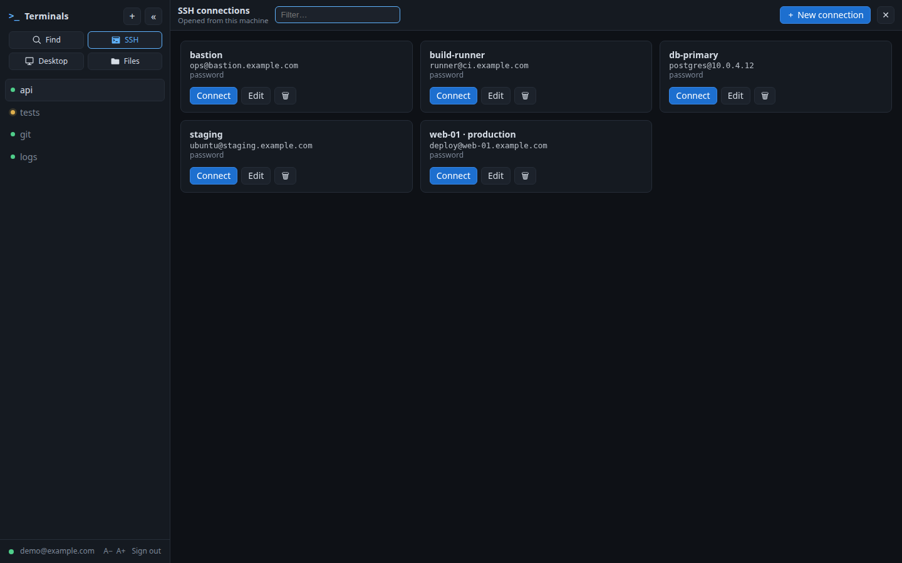
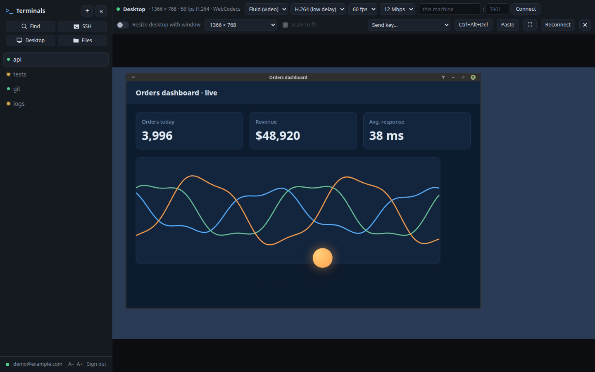
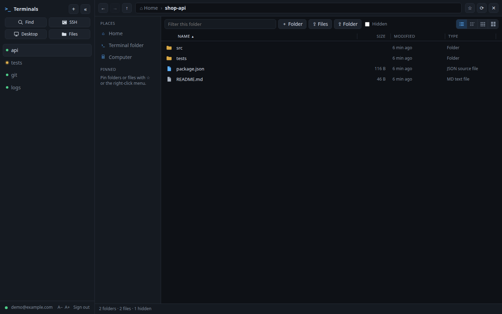
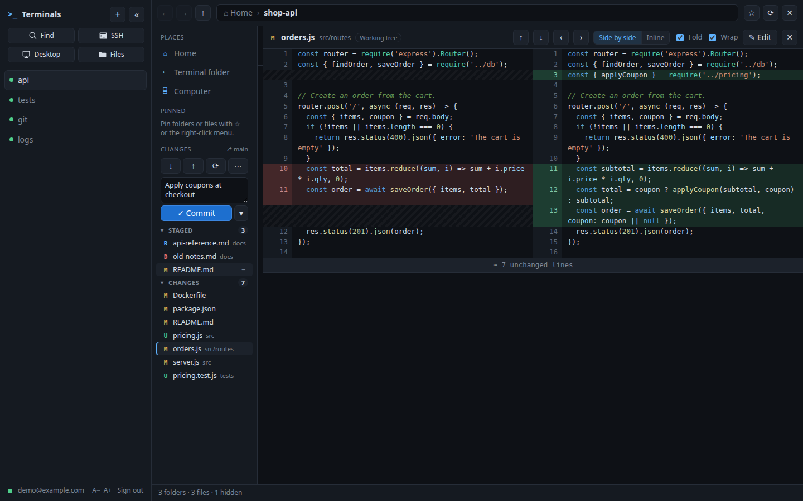
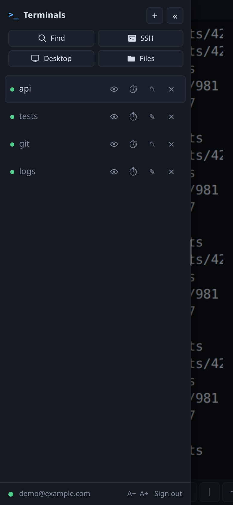
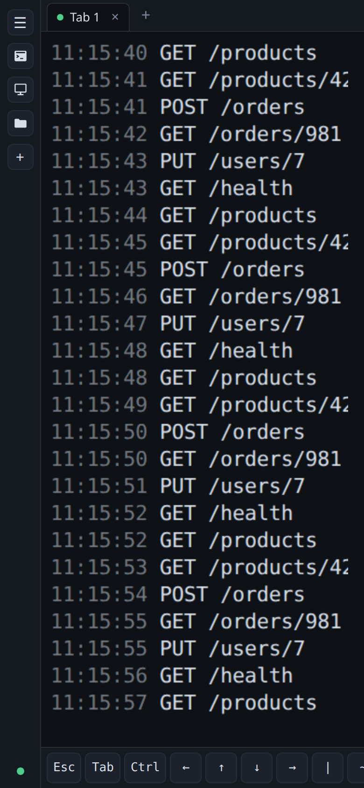

# Agent Warehouse

A web app that keeps all your terminals, remote connections and desktop in one browser tab. Run several real shells (and the coding agents or tools you start in them) on one machine, name them, split the screen, browse files, open saved SSH connections, and drive the machine's graphical desktop at up to 60 fps, from a laptop or a phone. Login is by email and password, and it is meant to sit behind Tailscale.

[](docs/demo.mp4)

<sub>The demo above (click it for the full-quality video) is a clean throwaway setup, not a real machine.</sub>

## Install it with an AI agent

The simplest and recommended way to install Agent Warehouse is to ask a coding agent (Claude Code, Codex, opencode or similar) to do it for you, on the machine where it should run. Send this request:

> Install AgentWarehouse for me, instructions in INSTALL.md

If you have not cloned the repository yet, give the agent the address as well:

> Install AgentWarehouse for me from https://github.com/cnmoro/AgentWarehouse, instructions in INSTALL.md

[**INSTALL.md**](INSTALL.md) is written for the agent. It checks the machine, installs the packages (Node.js, the build tools, and the optional SSH, ffmpeg and VNC parts), clones and builds the app, creates your login with a generated password, runs it as a systemd service, can set up the desktop and HTTPS through Tailscale, checks that everything works, and ends with a short report that has the address and the password. It never exposes the app to the public internet and asks you before it changes anything it should not.

The manual steps in [Setup](#setup) below are the same work, for reading or for doing by hand.

- **Rendering:** [xterm.js](https://xtermjs.org/), the same terminal emulator VS Code uses. `clear`, colors, progress bars, and full-screen TUIs (`htop`, `vim`, `less`) all work.
- **Shells:** [node-pty](https://github.com/microsoft/node-pty) runs a real login shell for each tab.
- **Reconnects:** the server keeps a headless xterm.js copy of each screen. If you reload the page, lose the connection, or open a second device, you get the current screen and scrollback back, including terminal modes such as mouse reporting and the scroll region. Programs keep running while no browser is connected.
- **Flow control:** the browser acknowledges output as it renders it, and the server pauses the program when the browser falls behind. Ctrl+C during a flood of ordinary output (`yes`, a big `cat`) takes effect in well under a second; floods of deliberately expensive escape sequences can take a few seconds on a very large screen. A browser that stops reading for 5 seconds (a sleeping laptop, say) no longer holds the program back; it gets a fresh copy of the screen when it wakes up.

## Tour

<table>
<tr>
<td width="50%"><a href="docs/images/sessions.png"></a><br><b>Sessions.</b> Every terminal is a named session in the sidebar, with a yellow dot when its screen changed since you last looked. They keep running when you close the page.</td>
<td width="50%"><a href="docs/images/split-screen.png"></a><br><b>Split screen.</b> Drag sessions onto the edges of the main area to show up to four at once, and drag the lines between them to resize.</td>
</tr>
<tr>
<td><a href="docs/images/files-thumbnails.png"></a><br><b>Files.</b> An explorer for the machine's own disk with details, list and thumbnail views, previews, uploads, drag and drop, cut/copy/paste.</td>
<td><a href="docs/images/ssh.png"></a><br><b>SSH connections.</b> Save hosts with a password or key (PuTTY <code>.ppk</code> works), and open each one as a new session with one click.</td>
</tr>
<tr>
<td><a href="docs/images/desktop.png"></a><br><b>Desktop.</b> The machine's virtual desktop in the page. <b>Fluid</b> mode streams video (H.264 or VP9) for up to 60 fps with a low delay; <b>VNC</b> mode works anywhere. Mouse, keyboard, shortcuts and clipboard in both.</td>
<td><a href="docs/images/files-details.png"></a><br><b>Details view.</b> Sortable columns, a filter box, keyboard navigation like a desktop file manager, and pinned places.</td>
</tr>
<tr>
<td colspan="2"><a href="docs/images/git-diff.png"></a><br><b>Git changes.</b> In a git repository, Files lists the changed files (staged, modified, added, deleted, renamed, untracked) under <i>Pinned</i>, and a click opens the diff, side by side or inline, with syntax highlighting, like VS Code. You can edit the file right there, stage, commit (with a message), push, pull and switch branches.</td>
</tr>
</table>

On a phone the sidebar becomes a drawer and a key bar adds Esc, Tab, Ctrl and the arrows:

<p>


</p>

## Setup

This is the manual version of what [INSTALL.md](INSTALL.md) has an agent do.

### What you need on the machine

| Needed for | What | Debian/Ubuntu package |
| --- | --- | --- |
| Everything | Node.js 22.9 or later, npm | `nodejs` (from NodeSource or nvm if the distro's is older) |
| Installing (node-pty is compiled) | `make`, `g++`, `python3` | `build-essential python3` |
| Login shells | `bash` (history handling is bash-specific) | `bash` |
| Default network binding | [Tailscale](https://tailscale.com/), up and logged in (or set `HOST`) | `tailscale` |
| Service mode | systemd user services, `loginctl enable-linger` | |
| **SSH connections** | OpenSSH client (`ssh`, `ssh-keygen`) | `openssh-client` |
| SSH with `.ppk` keys | `puttygen` | `putty-tools` |
| **Desktop (VNC)** | a VNC server running as the same user, such as TigerVNC's `Xvnc`, with a desktop session | `tigervnc-standalone-server tigervnc-common tigervnc-tools` plus a desktop (`xfce4`, `dbus-x11`) |
| Explorer thumbnails of videos and images, and the Desktop's **Fluid** mode | `ffmpeg` (with `x11grab` and `libx264`; `libvpx-vp9` adds the VP9 choice; `STREAM_NVENC=1` uses an NVIDIA GPU's `h264_nvenc` for H.264, but its streams make some browsers' GPU decoders add lag) | `ffmpeg` |
| Explorer "Trash" | `gio` | `libglib2.0-bin` (usually already there) |

Only Node and the build tools are required to start; each other row switches on one feature, and the page hides or explains a feature whose tool is missing. noVNC, xterm.js, marked and DOMPurify come from npm, so they need nothing more.

```sh
sudo apt install build-essential python3 openssh-client putty-tools ffmpeg \
  tigervnc-standalone-server tigervnc-common tigervnc-tools xfce4 dbus-x11
```

### Install

```sh
npm install
npm run set-user        # prompts for email and password (min. 12 characters); a script can pipe them in, see INSTALL.md
npm start
```

### Setting up the Desktop (VNC)

The Desktop button needs a VNC server of your own user to connect to; this app only relays to it (it does not start one). One-time setup:

```sh
vncpasswd                     # creates ~/.vnc/passwd; the app reads it and logs you in
cat > ~/.vnc/xstartup <<'EOT'
#!/bin/sh
unset SESSION_MANAGER
unset DBUS_SESSION_BUS_ADDRESS
[ -x /usr/bin/dbus-launch ] && eval `dbus-launch --sh-syntax --exit-with-session`
vncconfig -nowin &            # lets copy and paste work between the page and the desktop
exec startxfce4
EOT
chmod +x ~/.vnc/xstartup
vncserver :1 -localhost yes -geometry 1920x1080     # display :1 listens on port 5901
```

The app finds the running `Xvnc` by itself (or set `VNC_PORT`, `VNC_HOST`, `VNC_PASSWORD_FILE`). `-localhost yes` keeps the VNC port closed to the network, so the only way in is through this page and its login. Without `vncconfig` running, pasting into the desktop and copying out of it will not work. Do not probe the VNC port with scripts: TigerVNC blocks an address for a while after several connections that end before login.

With no `HOST` set, the server binds only to this machine's Tailscale IPv4 address on port 7681, e.g. `http://100.x.y.z:7681`. Other networks can't reach it. If Tailscale is not up yet, the server exits and systemd retries.

Requests must use one of this machine's own names: its Tailscale IPs, its MagicDNS name, its hostname or localhost. Other host names get a 421 error, which blocks DNS-rebinding attacks from web pages. Add extra names to `ALLOWED_HOSTS` (comma-separated) if you need them.

To run it as a service, see `deploy/web-terminal.service`.

### HTTPS with `tailscale serve` (recommended)

Tailscale already encrypts the traffic. HTTPS still helps in two ways: the browser treats the page as a secure context, so copying uses the async clipboard API, and the session cookie gets the `Secure` flag.

```sh
echo -e "TRUST_PROXY=1\nPORT=7681" > .env        # binds to 127.0.0.1
tailscale serve --bg --https=443 http://127.0.0.1:7681
```

Open `https://<machine>.<tailnet>.ts.net`. HTTPS certificates must be enabled for your tailnet (admin console → DNS → HTTPS Certificates).

## Using it

The sidebar lists sessions. Each session has one or more tabs, shown along the top of the terminal; each tab is its own shell.

| Action | How |
| --- | --- |
| New session | `+` in the sidebar. It opens in the current tab's folder. |
| New tab | `+` at the end of the tabs. It opens in the folder of the session's first tab. |
| Rename | Double-click a session or tab name, the ✎ button, or F2. Enter saves, Esc cancels. |
| Reorder | Drag sessions in the sidebar, or tabs along the top. |
| Close | ✕ or Delete; middle-click also closes a tab. Closing a session closes all its tabs. This kills the shells and anything running in them. |
| Move between tabs | Click. From the keyboard: **Ctrl+Shift+E** jumps to the tab list, then arrow keys and Enter; Esc goes back to the terminal. |
| Copy | Select with the mouse, then **Ctrl+C**. With nothing selected, Ctrl+C sends an interrupt as usual. **Ctrl+Shift+C** always copies. |
| Paste | **Ctrl+V** or **Ctrl+Shift+V**. Bracketed paste is used when the program supports it. |
| Font size | **Ctrl +**, **Ctrl −**, **Ctrl 0**, or A−/A+ in the sidebar footer |
| Full history | **Ctrl+Shift+H**, the ⏱ button on a tab, or the button that appears at the top of the scrollback |
| Hide sidebar | « in the sidebar header. It collapses to a narrow strip; ☰ brings it back. |

On a Mac, use Cmd instead of Ctrl for copy, paste, font size and Ctrl+Shift+E. Ctrl then always goes to the terminal.

Shortcuts match on the physical key, so they work with any keyboard layout. Because Ctrl+V pastes, programs never receive a literal Ctrl+V. In vim, use Ctrl+Q for visual-block mode.

The browser keeps some keys for itself, and they never reach the shell: Ctrl+T, Ctrl+N, Ctrl+Tab, Ctrl+PgUp/PgDn and Ctrl+Shift+T/N/W. Ctrl+W would close the page; you get a confirmation first, but it still does not delete a word. Use Alt+Backspace instead.

On a phone, press and hold on the terminal to select the word under your finger (it works inside `claude`, `opencode`, vim too); keep dragging to extend, or lift and pull the two handles at the ends of the selection; a small bar offers **Copy**, **Line** (the whole line) or ✕. The Ctrl key on the key bar applies to the next key you type and then releases by itself (also after 8 seconds, or when you switch tabs). On a phone, a row of keys under the terminal gives Esc, Tab, Ctrl (tap it, then a letter), arrows, and a few symbols that are awkward on phone keyboards. Swipe up and down to scroll: through the history, or, in full-screen programs (claude, opencode, vim, less), as the mouse wheel; a quick flick keeps going for a moment. The sidebar opens at 320 px wide here and its edge can be dragged.

The browser asks before you leave the page, so a stray Ctrl+W (delete word in bash) doesn't close it. The shells keep running either way.

A yellow dot on a tab means the text on its screen changed since you last looked; on a session, that one of its tabs did. Output that leaves the screen as it was (a program redrawing itself, a status message that disappears again) does not count. A grey dot means the shell exited. Press Enter in that tab to start a new one.

When two browsers show the same terminal, the one you used last sets its size, and the other follows it.

The magnifier in the sidebar (or Ctrl+Shift+K) finds a session by name: type some of its letters in order ("wf" finds "web-frontend"); Enter opens the best match, Esc closes the search. Hidden sessions are searched too.

### SSH connections

The SSH button in the sidebar opens a list of saved connections (name, host,
port, user, and a password and/or a key file): create, edit, delete, and
**Connect** opens a new session that is already logged in, with ssh started from
this machine. Drop a `.pem`, `.ppk` (PuTTY keys are converted to OpenSSH format
with `puttygen`, from the `putty-tools` package: `sudo apt install putty-tools openssh-client`) or OpenSSH key on the form;
Windows line endings and a missing final newline are fixed, public keys are
refused, and a passphrase can be saved too. Everything is stored on the server
in `DATA_DIR`: `ssh.json` (passwords and passphrases encrypted with the random
key in `ssh.key`, so the file alone reveals nothing), `ssh-keys/` (mode 0600).
Secrets are never sent back to the page; ssh gets them through `SSH_ASKPASS`
(`bin/wt-askpass`), once, and anything else it asks (a second try, a
verification code) is asked in the terminal. New hosts are trusted on first use
(`accept-new`); a changed host key is refused. Every terminal also has the
`wt-ssh <id>` command on its PATH, which is what the session runs: after a server
restart, Enter runs it again. Whoever signs in to this page can use the saved
connections, and whoever can read the data folder as this user can read the
secrets.

### Split screen

The area under the tab strip holds up to four panes, a 2x2 grid at most. Drag a
tab, a session from the sidebar, a pane's title bar, or the Files / Desktop
button over it: the half of the pane under the pointer, nearest the edge you
approach, takes it; the middle of a pane swaps the two. So you can have two
sessions side by side, a terminal and the explorer, or four terminals.
Clicking or typing in a pane gives it the keyboard (and the tab strip shows its
session); choosing a session or tab replaces what that pane shows. Drag the lines
between panes to resize (double-click: halves); the ✕ on a pane's title bar closes
the pane (the terminal keeps running). The arrangement of terminals is remembered
in this browser. Not offered on phones.

### Files

The folder button at the top of the sidebar (**Ctrl+Shift+F**, Cmd+Shift+F on a Mac) opens a file browser over the terminal, starting in your home folder.

- **Navigate:** double-click folders, click the path bar to type a path (`~` works), Backspace or Alt+↑ for the parent folder, Alt+←/→ for back and forward. Type a few letters to jump to a name; the filter box narrows the list. Drag the bars between Places, the list and the preview to resize them (double-click a bar to reset; the widths are remembered).
- **Views:** the four buttons at the right of the toolbar (or Ctrl+Shift+1 to 4, or the right-click menu) switch between **Details**, **List** (names flowing down in columns), **Small icons** and **Large icons**. The icon views show real thumbnails of images and videos (made by ffmpeg, cached in `data/thumbs/`). The view is remembered.
- **Columns (Details):** Name, Size, Modified, Created, Type, Extension, Permissions and Owner. Click a heading to sort by it (again to reverse; folders always stay first); right-click the heading row to choose the columns; drag a divider to resize a column, double-click it to fit the widest entry. When the list is narrow (a wide preview next to it, a phone) the columns that do not fit are left out; otherwise the table scrolls sideways. Created shows a dash where the file system keeps no creation date.
- **Select like in Windows Explorer:** click; Shift+click for a range; Ctrl+click to add or remove one (Cmd on a Mac); Ctrl+A for everything; press on empty space and drag a rectangle to select what it touches (hold Ctrl or Shift to add to the selection; the list scrolls when you drag past its edge).
- **Cut, copy, paste, move:** Ctrl+C / Ctrl+X / Ctrl+V work on files and folders inside the browser (cut files are shown dimmed; Ctrl+Shift+C copies their paths as text). Drag files onto a folder, a path segment or a pin to move them; hold Ctrl (Option on a Mac) to copy. If a name already exists you choose Replace, Keep both or Skip. F2 renames, Delete moves to the Trash, Alt+Enter shows properties.
- **Right-click** a file, a folder, several files or the empty space for the menu: open, play, cut, copy, paste, **Move up** (one folder up), **Move to…** and **Copy to…** (type a folder: absolute, `~/x`, or relative like `../x`), rename, download (folders as .zip), pin, open in terminal, new folder or file, select all or invert, properties, and more.
- **Places and pins:** Home, the folder of the terminal on screen, and the whole computer. Pin any folder or file with ☆ or the right-click menu; pins are saved on the server, per user.
- **Preview:** click a file. Text shows with line numbers (the first 1 MB), images are shown (click to switch between fit and actual size), **PDFs open in the browser's own viewer** (pages, zoom, search, print), **HTML pages are rendered** with their own stylesheets, images and fonts, but static: scripts, forms and links do not run, and an HTML or SVG file can be switched to its source with **View source**; SVG is shown as an image, and audio and video **play right in the preview** (seek, pause, full screen; Space pauses; moving with the arrow keys shows the next file without starting it). Formats the browser cannot play offer a download. Binary files offer a download. The list gives up its Modified and Size columns before it gets too narrow to read names.
- **Upload:** drop files or whole folders on the list (they go into the folder shown) or on a folder row, a pin or a path segment (they go there). The ⇪ buttons pick files or a folder. If something already exists you choose: replace, keep both, or skip.

Everything runs as the server's user, so the file browser can reach exactly what that user's shell can.

Markdown files (`.md`) are drawn in the preview (headings, lists, tables, code, pictures next to the file); untick *Render* to read the raw text. The HTML is sanitized (marked + DOMPurify), so scripts in a file never run.

#### Editing files

Click **✎ Edit** in the preview of a text file (`.txt`, `.md`, `.json`, code, config files...) to change it in place. The editor is a plain text box with syntax colors behind it: Tab and Shift+Tab indent, Enter keeps the indentation, Ctrl+Z undoes, **Ctrl+S** (or the Save button) writes the file. Leaving with unsaved changes asks first.

It is careful with files, so it only opens what it can save back without changing anything you did not touch:

- **Size:** files up to 1 MB. A bigger file (a CSV with millions of lines, a log) is still previewed (the first 1 MB), but Edit is disabled and says why. Above ~150 KB the colors and the change marks are switched off so typing stays quick.
- **Encoding and line endings:** the file must be valid UTF-8 with one kind of line ending. CRLF files stay CRLF and a UTF-8 byte order mark is kept. Binary, Latin-1 or mixed-ending files are shown read only.
- **Safe saving:** the file is written to a temporary file next to it and renamed over it, with its permissions kept. If the file changed on disk after you opened it, you are asked before your version replaces it.

#### Git changes

When the folder on screen is inside a git repository, a **Changes** section appears under *Pinned* in the left column, like VS Code's Source Control view. It shows the branch (with how far ahead or behind its upstream it is) and the changed files in three groups: **Conflicts**, **Staged** and **Changes** (modified, added, deleted, renamed and untracked files, each with a colored letter). A file that is staged and then edited again is in both groups. The list follows the repository as you work (it refreshes every few seconds while the panel is open).

Click a file to see its diff over the file list, with the same layout as VS Code:

- **Side by side** (old on the left, new on the right) or **Inline**; **Fold** hides the unchanged lines far from a change (click a fold to open it); **Wrap** wraps long lines.
- **Syntax highlighting** for JavaScript/TypeScript, JSON, HTML/XML, CSS/SCSS, Markdown, Python, shell, YAML, TOML/INI, SQL, Go, Rust, Java, Kotlin, C/C++/C#, PHP, Ruby, Swift, Dockerfile and many more ([highlight.js](https://highlightjs.org/), loaded the first time you open a diff).
- **↑ ↓** (F7 / Shift+F7) jump between the changes of the file, **‹ ›** (Alt+↑ / Alt+↓) go to the previous or next changed file, Esc goes back to the files. If the file changes on disk while its diff is open, the diff updates.
- **✎ Edit** (for the working-tree side) turns the right-hand side into the editor described above, next to the old version: the lines you changed are marked as you type, and Ctrl+S saves and returns to the diff.
- Binary files and files over 1.5 MB are listed but not shown.

The same section has the **git actions** of VS Code's Source Control view:

- **Stage and unstage** a file (hover it and use **＋** or **−**), or a whole group; **↶** discards a file's changes (a confirmation lists what is lost; an untracked file is deleted).
- **Commit** with a message in the box (Ctrl+Enter). With nothing staged the button reads *Commit All* and offers to stage everything. The **▾** next to it has *Commit All*, *Commit (Amend)*, *Commit & Push* and *Commit & Sync*.
- **↓ Pull**, **↑ Push** (the first push of a branch sets its upstream, `push -u`), **⟳ Sync** (pull, then push), and in **⋯**: *Pull (Rebase)*, *Push (Force, with lease)*, *Fetch*, *Stash*, *Stash (include untracked)*, *Pop stash* and *Undo last commit* (a soft reset: the changes stay staged).
- The branch name is a button: **switch branch** (local ones, and remote ones that become local), or **create a branch** and switch to it.
- Every action shows what git answered; a failure opens a dialog with git's own message.

Network actions never wait for a password: git runs without a terminal, so push, pull and fetch need credentials that work on their own (an SSH key without a passphrase, or one loaded in an agent the server can reach, or a stored HTTPS credential). When they do not, the dialog shows git's error. Hooks (`pre-commit` and the rest) run as they do on the command line.

It needs `git` on the machine; without it the section is not shown. On a narrow screen (a phone) the left column is hidden, and so is this view.

### Desktop

A monitor button in the sidebar opens the desktop of this machine's VNC server in the page. There are two ways to show it; the first box of the Desktop panel's header switches between them (the choice is remembered):

- **Fluid (video)**, the default when the server can do it: `ffmpeg` captures the VNC server's screen (`x11grab`), encodes it as video (**H.264**, the default and the one with the lowest delay, or VP9; H.264 uses `libx264`), and the page decodes it. Over **HTTPS** (or on localhost) it uses WebCodecs, which draws each frame as soon as it arrives and has the lowest delay; over plain HTTP it falls back to a `<video>` element with Media Source Extensions, which buffers a few frames more. To get HTTPS on a tailnet: `tailscale serve --https=8443 http://127.0.0.1:<port>` and open `https://<machine>.<tailnet>.ts.net:8443`. It reaches the full 60 fps (the boxes next to the mode set the codec, 30/45/60 fps and the bit rate; the status line shows the frame rate that is really being drawn). A stream needs about 4–12 Mbit/s and, with the GPU, roughly a tenth of a CPU core. The video starts only while the panel is open and the page is visible, and is captured again by itself whenever the desktop changes size. It only works for this machine's own desktop (not for another server typed into the boxes).
- **VNC**, the classic mode (noVNC): works with any VNC server. The *Quality* box trades sharpness for bandwidth (fast, balanced, high, best: JPEG quality 4/6/8/9 at the lowest compression levels, which keep the server's CPU use down). Here the frame rate is whatever the VNC server and the browser's decoder can manage: about 60 updates a second for a window-sized animation, less for a full 4K screen.

In both modes the keyboard and the mouse (buttons, wheel, every key and shortcut), the clipboard and the desktop's size go through the VNC connection, so Fluid mode has the same input as VNC mode. In full screen the browser is asked to pass keys it normally keeps (Esc, Alt+Tab, Ctrl+W...) to the desktop (Chrome and Edge, over HTTPS or localhost).

The Fluid mode changes nothing on the VNC server. Its settings are read from the environment: `VNC_DISPLAY` (the X display to capture, e.g. `:1`; by default the one of the Xvnc on the VNC port).

#### VNC server and noVNC

If this machine runs a VNC server (found automatically: the user's own `Xvnc`, or `VNC_PORT`; `VNC_HOST` and `VNC_PASSWORD_FILE` are the other settings), the monitor button appears. noVNC runs in the page. The server relays the browser's WebSocket (`/vnc`, signed-in sessions only, three at a time) to the VNC port, and does the VNC password step itself from `~/.vnc/passwd`, so there is nothing more to type; if that file cannot be read, noVNC asks for the VNC password instead.

- **Which server:** the two boxes at the top (host and port) pick the VNC server; empty means this machine's own. Type any address (`192.168.1.20` and `5900`, or a name; a port below 100 is a display number, so `1` means 5901) and press Connect. Another server asks for its VNC password in the page; this machine's own is logged in for you. Connecting to this machine by its network address works too, and arrives from a different address than `127.0.0.1`, which gets around a block at the VNC server. The choice is remembered. If the VNC server cannot be reached or refuses the login, the page says why.
- **Resize desktop with window:** while the switch is on, the desktop's resolution follows the size of the panel (resize the window, drag the sidebar). It is off by default, because it changes the real desktop for everyone looking at it.
- **Size:** the menu sets the desktop to a standard resolution (1024×768 up to 3840×2160, or a custom one) and turns the switch off; the desktop is then shown scaled to fit (**Scale to fit**) or at its own size with scrollbars. The last choice is remembered.
- **Ctrl+Alt+Del**, **Paste** (sends your clipboard's text to the desktop's clipboard; what the desktop copies arrives on yours), full screen, and Reconnect. Closing the panel disconnects.

Resizing needs a VNC server that supports it (TigerVNC's `Xvnc` does).

### Long history

The terminal itself keeps the last 10,000 lines (`SCROLLBACK`). Everything older is moved to disk, up to 200,000 lines per tab by default (`HISTORY_LINES`), and loaded only when you look at it:

- Scroll to the top of a terminal and a button offers the older lines. **Ctrl+Shift+H** (or ⏱ on the tab) opens the full history of the tab at any time.
- The history view draws only the rows on screen and fetches the rest from the server as you scroll, so a million lines cost about as much as a hundred. Colours are kept.
- Search with the box at the top: Enter finds the next older match, Shift+Enter the next newer one; it wraps around at the ends. Searching a million lines takes a fraction of a second.
- Select and copy text as on any web page. Long lines that the terminal wrapped are copied as one line.
- Ctrl+L (erase the screen) moves the screen's content into the scrollback instead of destroying it, as most terminals do. `clear` erases the history too, as it erases the scrollback in any terminal. A terminal reset (`reset`, or binary output that happens to contain the reset code) keeps it and adds a marker line. The history survives a server restart (the programs that produced it do not). Closing a tab deletes its history.

History is stored in `data/history/<tab>/` (readable only by you). Each tab keeps at most `HISTORY_LINES` lines (default 200,000) and `HISTORY_MB` megabytes (default 64); the oldest lines are dropped beyond either limit. Plain text needs about 10–20 MB for 200,000 lines; heavily coloured output reaches the megabyte limit sooner. Set `HISTORY_LINES=0` to turn history off. If the disk fills up, history stops for that tab and the terminal carries on. Archiving costs some throughput during extreme output floods (about 25% at a full-speed `cat` of a log), none at normal use.

### After a server restart

The tabs come back with the same names, in the same folders, at the same size, still showing what they showed. Programs that were running do not survive a restart, but:

- What was on screen stays. The newest 2,000 lines of each tab are written back into it (scroll up to see them; older ones are in the history view, Ctrl+Shift+H), followed by a `── server restarted ──` line. A full-screen program (`claude`, vim, htop) draws on a separate screen that is normally lost when it ends: at shutdown, what it was showing is saved too, under a heading such as `── claude was showing this when the server stopped ──`.
- If a command was running in a tab (say `claude`), the tab shows a short note, and once the shell shows its prompt the command is typed there, exactly as you entered it. Press Enter to start it again, or Ctrl+U to clear it. Nothing runs by itself, and nothing is typed while your startup files are still running or asking questions. The command is also the newest history entry, so ↑ brings it back if you cleared it. A command you hid from history with a leading space is not offered.
- Each tab keeps its own bash command history, saved after every command, so ↑ recalls what you ran in that tab. A new tab starts with a copy of your normal `~/.bash_history`. Commands typed in the web terminal are not added to `~/.bash_history`.

The state is saved every 10 seconds and on shutdown, in `data/tabs.json` and `data/shells/`; what the tabs showed is in `data/history/`.

Terminals start without the `CLAUDECODE` / `CLAUDE_CODE_*` variables of a Claude Code session the server may have been started from: inherited, they would stop `claude` in the web terminal from saving its conversations (so `claude -r` would have nothing to resume).

When the server stops, it hangs up every program started in any tab (including jobs left behind by shells that have exited), waits up to 2 seconds, then kills whatever is left. Run as the systemd service, it also stops programs that detached into their own session (`setsid`, daemons, tmux servers), so a stop or restart takes about 2 seconds and nothing keeps running. Started by hand (`npm start`), such detached programs are left alone, as they would be when closing any terminal.

## Limits

The screen you get back after a reload or on a second device matches the live one cell for cell, with these exceptions:

- Scrollback is shortened when a snapshot would exceed 2 MB (heavily coloured history).
- Tab stops, underline styles (curly, double, coloured) and national character sets other than DEC line drawing are not restored.

Some terminal features are limited on purpose, because programs (or files you `cat`) could otherwise freeze or crash the server or the browser:

- OSC 8 hyperlinks are ignored. Plain URLs in the output are still clickable.
- Escape strings (titles, clipboard, sixel, etc.) over 64 KB and colour palette sequences over 16 KB are ignored.
- A character cell holds at most 6 UTF-16 code units (a letter with up to five accents). Emoji sequences can grow to 16 units with emoji parts (joiners, skin tones, tags), which covers family emoji and flags. Extra combining marks are dropped.
- Resizing a very wide terminal whose whole history is unusual text, or taking a snapshot of a very wide, heavily coloured screen, can pause the server for up to a second or two. This happens once per resize or attach.
- Megabytes of deliberately unusual glyphs (thousands of distinct mark stacks) can still pause the visible tab for about a second while the browser draws them. The server and other tabs are not affected.
- Huge repeat counts in scroll, insert/delete-line, tab and repeat-character sequences are cut to the screen size.
- In the browser, colour changes and cursor-blink changes are rate-limited during floods.
- Answers to terminal queries (cursor position, colours, etc.) are dropped while more than about a thousand are waiting for a program that isn't reading them.

## Security

This page gives full shell access as the user running the server. The defences:

- Binds to the Tailscale interface (or to localhost behind `tailscale serve`), never to `0.0.0.0` by default.
- Accepts only this machine's own host names (see above), so a web page can't use DNS rebinding to reach the server.
- Passwords are hashed with scrypt (N=2¹⁵, r=8) in `data/users.json` (mode 600). Unknown emails still get a full hash check, so response time does not show which accounts exist.
- Login throttling: 5 attempts per IP per 15 minutes, counted before the password is checked, so parallel requests can't get around it. At most 4 password checks run at once. There is no global lockout, so failed attempts from elsewhere can't lock you out.
- Sessions use a 256-bit random token in an `HttpOnly`, `SameSite=Strict` cookie. The server stores only its SHA-256 hash, in memory. Sessions end after 24 h idle or 7 days, on sign-out, on server restart, or within 10 seconds of the user's password being changed or the user being removed.
- Links from terminal output only open if they are `http` or `https`.
- The WebSocket handshake and the login/logout endpoints reject requests whose `Origin` does not match the host. This blocks cross-site WebSocket hijacking and CSRF.
- A strict Content-Security-Policy (no inline scripts, no third-party origins), `frame-ancestors 'none'`, and `no-store` caching.

In plain-HTTP mode, browsers send the session cookie to every service on the same address, whatever the port (cookies are not separated by port). Any other web server on this machine's Tailscale IP would receive it. If other people can run services on this machine, use the HTTPS setup with `tailscale serve`, which gives the terminal its own host name.

Manage users:

```sh
npm run set-user                                     # add a user or change a password
npm run set-user -- --remove someone@example.com     # remove a user
```

## Configuration

See `.env.example`: `PORT`, `HOST`, `ALLOWED_HOSTS`, `TRUST_PROXY`, `SESSION_TTL_HOURS`, `SESSION_IDLE_HOURS`, `SCROLLBACK`, `HISTORY_LINES`, `HISTORY_MB`, `VNC_PORT`, `VNC_HOST`, `VNC_PASSWORD_FILE`, `VNC_DISPLAY`, `DATA_DIR`.

## Layout

```
server.js            HTTP routes, login, WebSocket protocol
lib/auth.js          password hashing, sessions, login throttling
lib/terminals.js     pty + headless mirror per tab, persistence of tab list
lib/history.js       on-disk history beyond the scrollback
lib/files.js         file explorer API
lib/vnc.js           WebSocket relay to the VNC server
lib/stream.js        Fluid desktop: ffmpeg screen capture to video over a WebSocket
lib/ssh.js           saved SSH connections and key conversion
LICENSE             MIT license
INSTALL.md          step-by-step installation instructions for an AI agent
docs/               screenshots and the demo video used in this README
bin/, scripts/wt-ssh.js   wt-ssh and the askpass helper on every terminal's PATH
scripts/set-user.js  create, update, or remove logins
public/              login page and the app (plain JS, no build step)
data/                users.json, tabs.json, history/ (git-ignored)
```

## License

[MIT](LICENSE). The bundled libraries (xterm.js, noVNC, marked, DOMPurify and the rest of `package.json`) have their own licenses.
